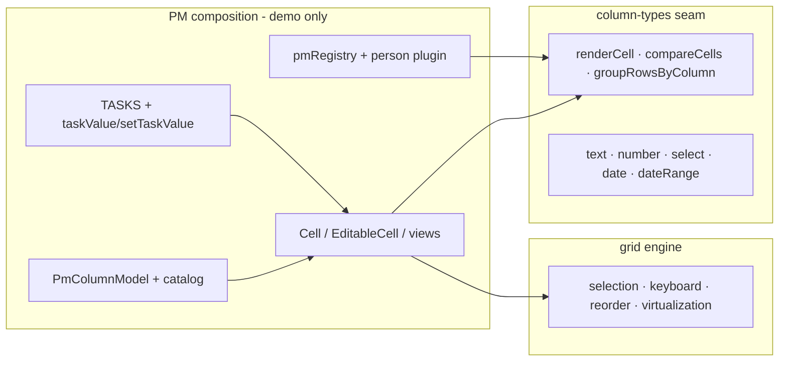
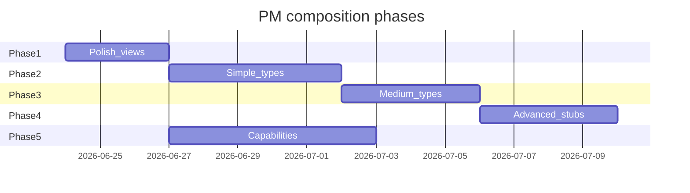

# Finish PM composition — full phased roadmap

## Current state

The Projects tab ([`apps/playground/src/demos/projects/`](apps/playground/src/demos/projects/)) is a **PM composition** over two engine layers:



**Shipped today (6 types, `available: true`):** text, number, select, date, dateRange, person ([`column-model-catalog.ts`](apps/playground/src/demos/projects/column-model-catalog.ts))

**Still "Coming soon":**
- **11 column types** — no `ColumnType` plugin registered yet
- **5 capabilities** — filter, validation, aggregation, reorder (persist), conditional formatting

**Known PM gaps (not in catalog but incomplete):**
- Inline edit only in table view; list/board are read-only [`projects-page.tsx`](apps/playground/src/demos/projects/projects-page.tsx)
- Dead duplicate file [`column-model-panel.tsx`](apps/playground/src/demos/projects/column-model-panel.tsx) (superseded by header sheet + [`projects-column-editor.tsx`](apps/playground/src/demos/projects/projects-column-editor.tsx))
- Board card title uses `task.title` raw string, not [`Cell`](apps/playground/src/demos/projects/cell.tsx) pipeline
- `reorder` capability flagged false though column/row drag works in-session only
- Person stores id only; no avatar URL in [`pm-schema.ts`](apps/playground/src/demos/projects/pm-schema.ts)

---

## Phase 1 — PM polish (demo-only, no new types)

Goal: make the existing 6 types feel complete across all view modes.

| Task | Files | Notes |
|------|-------|-------|
| Delete dead `column-model-panel.tsx` | remove file | Logic already lives in sheet + editor |
| Shared edit state | new `use-pm-tasks.ts` or lift state in [`projects-page.tsx`](apps/playground/src/demos/projects/projects-page.tsx) | Single `tasks` + `setTaskValue` path for table/list/board |
| List/board inline edit | [`projects-page.tsx`](apps/playground/src/demos/projects/projects-page.tsx), reuse [`EditableCell`](apps/playground/src/demos/projects/editable-cell.tsx) | Same click-again / Enter / type-to-edit UX as table |
| Board title via pipeline | `BoardView` | Render title through `Cell` + `titleSchema`, not `task.title` |
| Person avatars | [`pm-schema.ts`](apps/playground/src/demos/projects/pm-schema.ts), [`cell.tsx`](apps/playground/src/demos/projects/cell.tsx) | Add `avatarUrl?` to `Person`; `Cell` renders nqui `Avatar` when `style` carries avatar data (extend `CellStyle` usage in demo only, or add optional `avatarUrl` on parsed person style) |
| Session column-order persist | [`projects-page.tsx`](apps/playground/src/demos/projects/projects-page.tsx) + `localStorage` | Save/restore `columnModels` order on drag; flip `reorder` to `engineReady: true` in catalog once persist works |
| Optional: table timeline strip | [`projects-page.tsx`](apps/playground/src/demos/projects/projects-page.tsx) | Re-add `TimelineStrip` as shell footer (not flex sibling) so layout does not collapse |

**Exit criteria:** all three views editable; capability matrix shows reorder as Engine; no dead files.

---

## Phase 2 — Simple column types (app registry plugins)

Goal: unlock the next batch of catalog entries without bloating engine core. Follow the **`person` pattern** in [`pm-schema.ts`](apps/playground/src/demos/projects/pm-schema.ts): register on `pmRegistry`, store **raw id/scalar only**, resolve in `parse/format/style`.

Create [`apps/playground/src/demos/projects/pm-types/`](apps/playground/src/demos/projects/pm-types/) (barrel `index.ts` → `pmRegistry.register(...)`).

| Type | Raw stored | Plugin sketch | EditableCell |
|------|------------|---------------|--------------|
| **checkbox** | `boolean` | parse bool; format `"Yes"`/`""`; style muted when false; `editor: checkbox` | nqui `Switch` |
| **url** | `{ url, label? }` or string | format label or host; style link hint | text input; `Cell` renders `<a>` |
| **email** | string | format as-is; `mailto:` in Cell | text input |
| **duration** | number (minutes) | format `"3h 30m"` via number format suffix pattern | number input |
| **rating** | number 0–5 | format stars string or bar in style | number/stepper |

For each type:
1. Implement `ColumnType` in `pm-types/<name>.ts`
2. Add sample column + seed data in [`pm-schema.ts`](apps/playground/src/demos/projects/pm-schema.ts) `TASKS` (or optional demo column in `DEFAULT_COLUMN_MODELS`)
3. Set `available: true` in [`column-model-catalog.ts`](apps/playground/src/demos/projects/column-model-catalog.ts)
4. Extend [`editable-cell.tsx`](apps/playground/src/demos/projects/editable-cell.tsx) + [`cell.tsx`](apps/playground/src/demos/projects/cell.tsx) for any new editor control

**Engine touch (minimal):** extend `EditorControl` in [`src/engine/column-types/contract.ts`](src/engine/column-types/contract.ts) with `"checkbox"` (and optionally `"multiSelect"`) — declarative only, no React in engine. Note in `CHANGELOG.md` if public type changes.

**Exit criteria:** 5 more types addable via "+ Add field"; catalog badges flip to Engine.

---

## Phase 3 — Structured column types (medium complexity)

| Type | Raw | Approach |
|------|-----|----------|
| **multiSelect** | `string[]` of option ids | `parse` → resolved options; `format` → joined labels; `compareKey` → count then labels; `editor: multiSelect` with nqui multi combobox |
| **labels** | same as multiSelect | Alias or thin wrapper over multiSelect with chip row style |
| **richText** | markdown string | `format` strips to plain preview; `editor: text` (textarea); full markdown render in Cell optional |

**Board grouping:** only `select` supports `boardGroup` today ([`pm-column-model.ts`](apps/playground/src/demos/projects/pm-column-model.ts)). Keep that rule; document in column sheet UI.

**Exit criteria:** 8 more catalog types available (11 total new simple+medium); multi-value chips render in table/list/board.

---

## Phase 4 — Advanced types (demo stubs vs real)

These are PM-product shapes; ship **read-only or stub editors** first so the catalog is honest, then deepen.

| Type | Phase 4a (stub) | Phase 4b (real, later) |
|------|-----------------|------------------------|
| **formula** | `editor: none`; display computed from row in `parse` using demo expression | expression AST in engine |
| **relation** | raw foreign id; format via lookup table | join resolver |
| **file** | raw attachment id; format filename | upload widget |
| **rollup** | `editor: none`; demo aggregate of child rows | hierarchical row model |
| **dependency** | raw `{ blocks, blockedBy }[]`; format count | graph UI / nqgantt seam |

Mark `available: true` only when parse/format/style/editor are coherent; use `editor: none` + Coming soon badge in sheet for incomplete editors.

---

## Phase 5 — Engine capabilities (catalog `engineReady: false`)

Wire capabilities using existing playground patterns; keep domain logic in PM layer where possible.

### 5a Column filter (`filter`)
- Add search bar to [`projects-page.tsx`](apps/playground/src/demos/projects/projects-page.tsx) header (pattern: [`portfolio-table.tsx`](apps/playground/src/demos/portfolio-table.tsx) `createGlobalFilterFn`)
- Filter on **raw** task fields via `taskValue`, not display strings
- Optional: per-column faceted filter for `select` using option ids
- Set `filter.engineReady: true` in catalog

### 5b Validation (`validation`)
- In [`editable-cell.tsx`](apps/playground/src/demos/projects/editable-cell.tsx): before `onCommit`, run `type.parse(raw, schema)`; if `CellTypeError`, show inline error and reject commit
- Column sheet: "Required" toggle on `PmColumnModel` (demo metadata)
- Set `validation.engineReady: true`

### 5c Footer aggregation (`aggregation`)
- Add optional footer row to [`projects-grid-table.tsx`](apps/playground/src/demos/projects/projects-grid-table.tsx) via `EngineScrollTableShell` footer
- Sum/avg `number` columns using parsed raw values (budget, effort, progress)
- Set `aggregation.engineReady: true`

### 5d Conditional formatting (`conditionalFormat`)
- **Demo-layer only:** `PmColumnModel.rules?: { when: string; style: Partial<CellStyle> }[]` evaluated in [`cell.tsx`](apps/playground/src/demos/projects/cell.tsx) after `renderCell`, merging override styles (e.g. progress &lt; 20% → destructive variant)
- Document as composition pattern; engine stays predicate-free unless we later add `ColumnType.conditionalStyle?`
- Set `conditionalFormat.engineReady: true` when demo rules work

---

## Architecture rules (hold throughout)

Per [`columntype-contract.md`](/Users/bnguyen/Desktop/Github/nqlib/columntype-contract.md) and [`CLAUDE.md`](CLAUDE.md):

1. Rows store **raw scalars/ids only** — editors call `setTaskValue(task, columnId, raw)`
2. New types = **registry plugins**, never `if (type === "person")` in `src/engine`
3. Engine ships **data** (`CellStyle`, `EditorDescriptor`); nqui visuals stay in `Cell` / `EditableCell`
4. Promote a plugin from `pm-types/` → `src/engine/column-types/types/` only when it is generic enough for all consumers (like `select`, not like `person` with hardcoded TEAM)

---

## Suggested implementation order



Phase 5 can overlap Phase 2–3 after Phase 1 lands (filter/validation are independent of new types).

---

## Verification (each phase)

```bash
pnpm --filter nqgrid-playground exec tsc --noEmit
pnpm --filter nqgrid-playground test
```

Manual smoke on Projects tab: add field, edit cell in table/list/board, board grouping, capability badges update, filter/validation/aggregation if in scope.

Engine changes (Phase 2+): also run `pnpm lint && pnpm test && pnpm build` and note public API changes in `CHANGELOG.md`.
