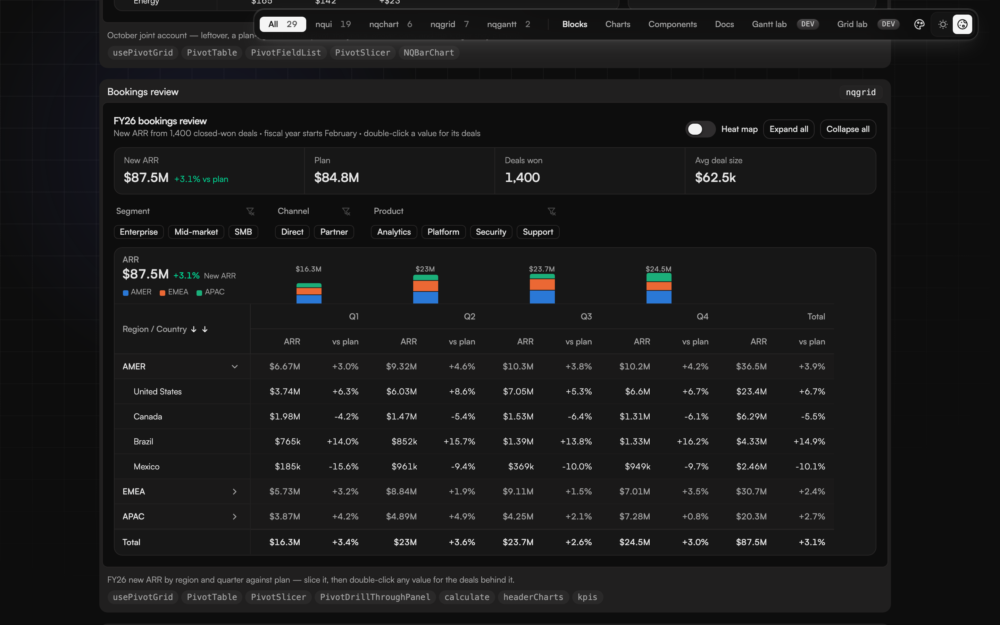

# @nqlib/nqgrid

<p align="center">
  
</p>

Headless tables and pivots for React. The engine owns the grid. nqui supplies the surrounding controls.

## Use

```bash
npm install @nqlib/nqgrid @tanstack/react-table
```

```tsx
import { PivotTable } from "@nqlib/nqgrid/pivot"
```

Pivot, virtual sheets, and the grid guide: [nqlib.com/docs/nqgrid](https://nqlib.com/docs/nqgrid)

Docs in this repo: [pivot core & export](docs/pivot-headless.md) · [recipes (P&L / income statement)](docs/pivot-recipes.md) · [performance](docs/pivot-performance.md)

## Customize the design

`PivotTable` (0.5.0) lets a host app offer a design editor without the grid storing anything. Every
design prop is optional, and with none set the markup is the same as 0.4.0. Each change comes out
through a callback. The host stores it (e.g. in chart params) and passes it back as a prop.

```tsx
const [design, setDesign] = useState(savedDesign)

<PivotTable
  model={model}
  valueWidths={design.valueWidths}            // width per value column, by PivotValueColumn.id
  dimensionWidths={design.dimensionWidths}
  rowHeight={design.rowHeight}
  measureOrder={design.measureOrder}
  onValueWidthChange={(key, width, info) => setDesign((d) => ({ ...d, valueWidths: { ...d.valueWidths, [key]: width } }))}
  onDimensionWidthChange={(i, width) => setDesign((d) => ({ ...d, dimensionWidths: Object.assign([...(d.dimensionWidths ?? [])], { [i]: width }) }))}
  onRowHeightChange={(rowHeight) => setDesign((d) => ({ ...d, rowHeight }))}
  onMeasureOrderChange={(measureOrder) => setDesign((d) => ({ ...d, measureOrder }))}
  freezeHeader
  freezeDimensions
  heat={[{ measure: "actual" }, { measure: "variance", scale: "diverging", midpoint: 0 }]}
  bars={[{ measure: "plan", negative: "left" }]}
  measureLayout={{ variance: { align: "center" } }}
  bandedRows
  dataAttributes
  cellClassName={(ctx) => (ctx.cell.value !== null && ctx.cell.value < 0 ? "text-destructive" : undefined)}
/>
```

| Need | Props |
|---|---|
| Column widths | `valueWidths`, `dimensionWidths`, `onValueWidthChange`, `onDimensionWidthChange`. Drag the handle on a header's right edge (48–800 px), double-click it to fit the widest rendered cell, or focus it and press ArrowLeft / ArrowRight (8 px; Shift 32 px). |
| Row height | `rowHeight`, `onRowHeightChange`: the handle on the bottom edge of the first body row (20–96 px). |
| Measure order | `measureOrder`, `onMeasureOrderChange`. Drag a measure header (a drop indicator shows the place; Escape cancels), or focus it and press Alt+ArrowLeft / Alt+ArrowRight. Column-dimension members keep the model's sort. |
| Freeze | `freezeHeader`, `freezeDimensions` (both on by default in interactive mode; work with `virtualize` and `pagination`). |
| Style hooks | `cellClassName`, `rowClassName`, `headerClassName`, `bandedRows` (`data-nq-band`), `dataAttributes` (`data-nq-measure`, `data-nq-row-kind`, `data-nq-negative`). The grid adds no colors: map these to your own tokens. |
| Heat | `heat`: one `PivotHeatSpec` or a list (one per measure), each `sequential` or `diverging` around a `midpoint`. Cells get `data-nq-heat="0…8"` and `data-nq-heat-scale`. |
| Data bars | `bars`: `PivotBarSpec[]` with `measure`, `applyTo`, `domain`, `negative: "left" \| "hide"`. The number stays the cell's selectable text. |
| Per-measure layout | `measureLayout`: `align` and `wrap` per measure id. Rename a header with `renderColumnHeader` (return your own label). |
| Export the same design | `pivotTableGeometry(model, { valueWidths, freezeHeader, heat, bars, … })` returns `columnWidths`, `frozenRows`, `frozenColumns` and the heat / bar level of each cell for XLSX. |

Colors come from CSS variables that you define (no colors in JavaScript):

```css
.my-pivot {
  --nq-pivot-heat-0: color-mix(in oklab, var(--primary) 6%, transparent);
  /* … --nq-pivot-heat-1 … --nq-pivot-heat-8 */
  --nq-pivot-heat-diverging-0: color-mix(in oklab, var(--destructive) 60%, transparent);
  /* … --nq-pivot-heat-diverging-4 is neutral … --nq-pivot-heat-diverging-8 */
  --nq-pivot-bar: color-mix(in oklab, var(--primary) 28%, transparent);
  --nq-pivot-bar-negative: color-mix(in oklab, var(--destructive) 28%, transparent);
  --nq-pivot-drop-indicator: var(--primary);
}
.my-pivot [data-nq-band="even"] > td { background-color: var(--muted); }
.my-pivot [data-nq-negative] { color: var(--destructive); }
```

Full reference: [Customize the design](docs/pivot-headless.md#customize-the-design-050).

